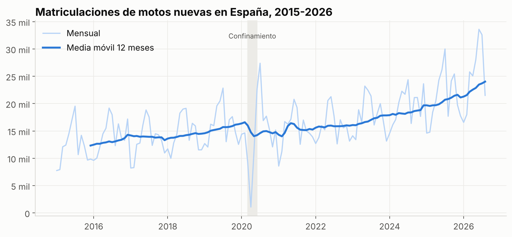
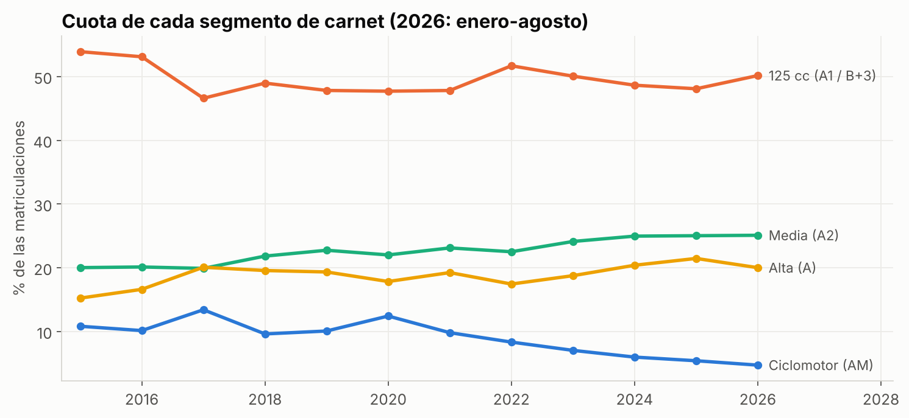
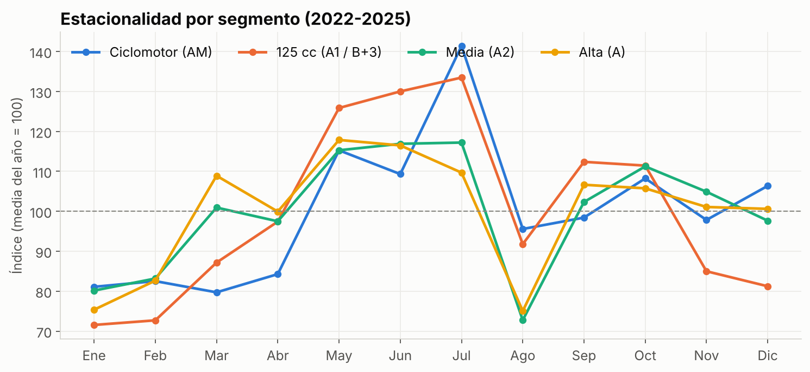
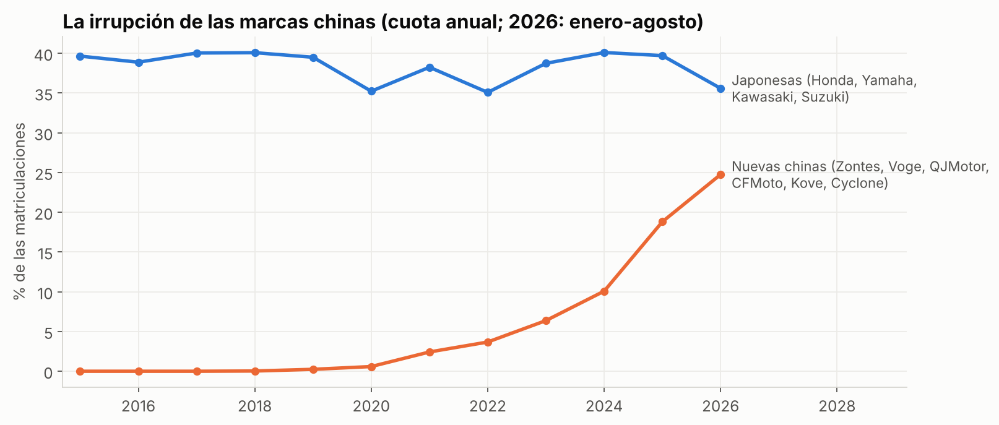
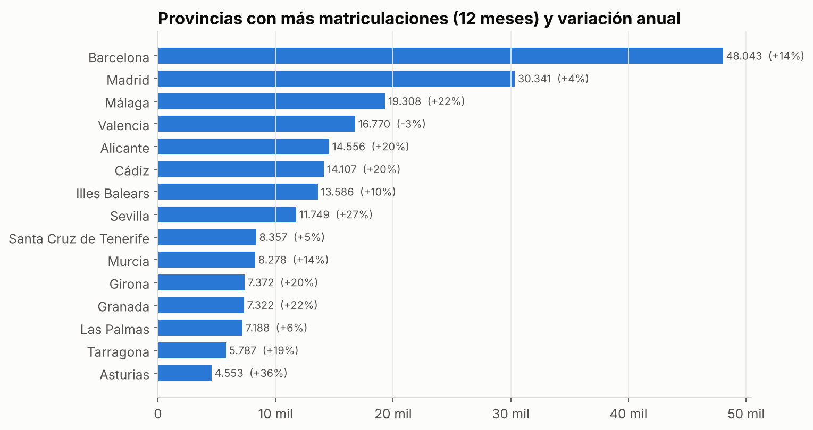
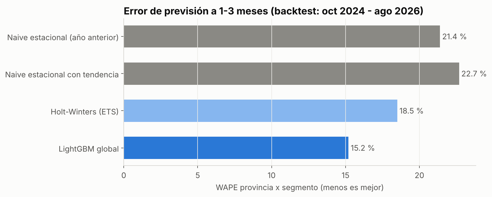
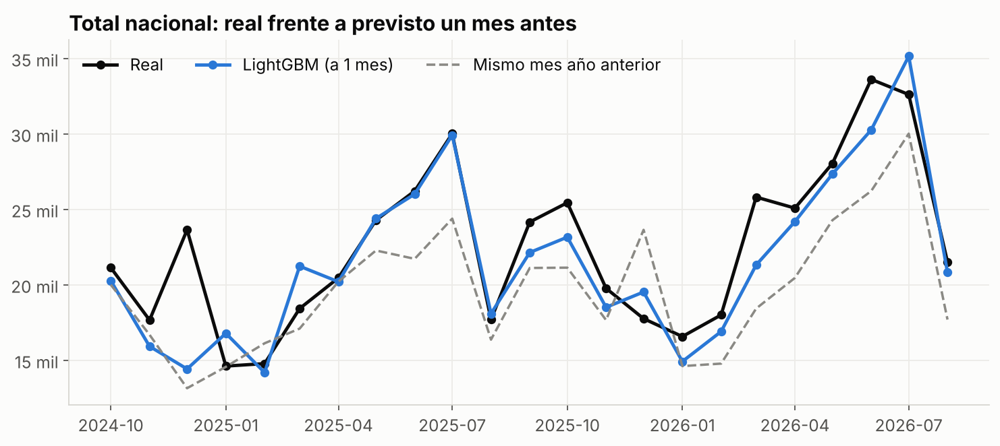
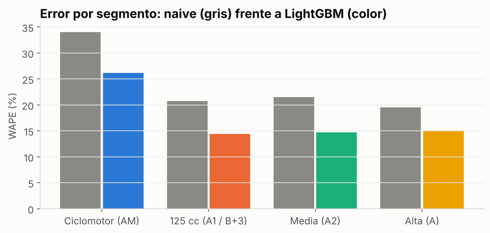
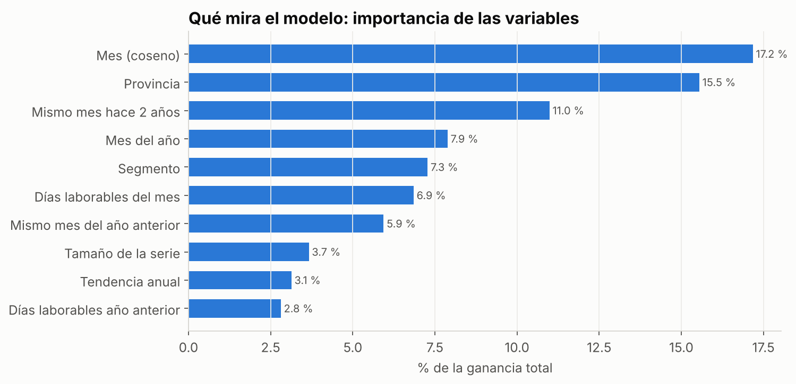

# MotoRadar: previsión de la demanda de motos por provincia y carnet con datos abiertos de la DGT

**Trabajo Fin de Máster** · Máster en Data Science & Inteligencia Artificial · Evolve Academy
**Autor:** Juanjo · Octubre de 2026

---

## Resumen

Los concesionarios de motos piden su stock a las marcas con uno a tres meses de antelación y sin una previsión de la demanda de su zona. Este trabajo construye **MotoRadar**, un sistema que predice las matriculaciones de motos nuevas de los tres meses siguientes en cada provincia española y para cada tipo de carnet (AM, A1, A2 y A), y lo sirve en una aplicación web que traduce la previsión a unidades a pedir.

Se han procesado los microdatos oficiales de matriculaciones de la DGT de enero de 2015 a agosto de 2026 (140 meses, 2,3 millones de motos nuevas). Un modelo global de *gradient boosting* (LightGBM), entrenado a la vez con las 208 series provincia × segmento, se ha comparado con tres alternativas mediante validación de origen móvil durante 23 meses. Su error (WAPE) es del **15,2 %**, frente al 21,4 % del método habitual ("el mismo mes del año pasado") y al 18,5 % de Holt-Winters: una mejora del **29 %** (IC 95 %: 22-35 %) y del 18 % (IC 95 %: 9-26 %) respectivamente. El rango de predicción del 80 % contiene el valor real el 81 % de las veces fuera de muestra.

El análisis exploratorio documenta además un mercado en plena transformación: +71 % de 2015 a 2025, caída de los ciclomotores del 11 % al 5 % del mercado y la irrupción de las marcas chinas, que han pasado de casi 0 a una de cada cuatro motos nuevas en seis años.

---

## 1. Introducción y motivación

España es uno de los grandes mercados de motos de Europa y ha vivido una década de crecimiento: de 148.000 motos nuevas en 2015 a 254.000 en 2025. Detrás de ese crecimiento hay cambios profundos: la moto como alternativa al coche en las ciudades, la convalidación del carnet B para conducir motos de 125 cc y la llegada de fabricantes chinos con precios muy competitivos.

Para un concesionario, este contexto complica la decisión más importante del mes: **qué y cuánto pedir**. Las marcas trabajan con plazos de semanas o meses, la demanda es muy estacional (se concentra entre marzo y julio) y equivocarse sale caro en las dos direcciones: el exceso de stock inmoviliza dinero y las roturas de stock en temporada son ventas perdidas. Hoy la mayoría decide "como el año pasado", un método que en un mercado que crece un 15-20 % anual se queda sistemáticamente corto.

La motivación personal es doble: soy aficionado a las motos y he trabajado este dominio a lo largo del máster (base de datos de ventas de concesionarios en el proyecto de SQL y asistente RAG sobre normativa de motos en el de IA generativa). El TFM integra ambas experiencias en un producto completo con datos reales.

## 2. Objetivos

**Objetivo general.** Construir y validar un sistema de previsión de la demanda de motos a 1-3 meses por provincia y segmento de carnet, útil para planificar el stock de un concesionario.

**Objetivos específicos.**

1. Obtener, depurar y agregar los microdatos oficiales de matriculaciones de la DGT de forma reproducible.
2. Caracterizar el mercado: tendencia, estacionalidad, segmentos, marcas y geografía.
3. Comparar modelos de previsión con una validación temporal rigurosa y elegir el mejor con un criterio estadístico.
4. Cuantificar la incertidumbre con intervalos de predicción calibrados.
5. Desplegar el resultado en una aplicación que traduzca la previsión a decisiones (pedido de stock).

## 3. Contexto

**Previsión de la demanda en distribución.** La práctica habitual en pequeños distribuidores son métodos *naive* (mismo periodo del año anterior, con o sin corrección de tendencia). Los métodos estadísticos clásicos (suavizado exponencial, Holt-Winters, ARIMA) ajustan un modelo por serie. En la última década, las competiciones de previsión (como M5, sobre ventas de Walmart) han mostrado que los **modelos globales de *gradient boosting***, entrenados con muchas series a la vez y variables bien construidas, suelen superar a los modelos por serie cuando hay muchas series relacionadas.

**Segmentos por carnet.** El Reglamento General de Conductores define qué motos puede llevar cada permiso: AM (ciclomotores, desde 15 años), A1 (hasta 125 cc y 11 kW, desde 16 años), A2 (hasta 35 kW, desde 18 años) y A (sin límite, tras dos años con A2). En España, el permiso B con más de tres años de antigüedad permite conducir motos de la categoría A1. Esta segmentación es la que usa el negocio: el carnet del cliente determina qué moto puede comprar.

## 4. Datos

### 4.1 Fuente

**Microdatos de matriculaciones de vehículos de la DGT**, fichero mensual. Cada mes es un ZIP con un fichero de texto de ancho fijo y una línea por vehículo matriculado en España (unos 130.000 al mes, de todos los tipos). Incluye fecha, marca, modelo, tipo de vehículo, cilindrada, potencia, propulsión, provincia, si el vehículo es nuevo o usado importado y si el titular es persona física o jurídica. Es pública, gratuita y está disponible desde diciembre de 2014.

### 4.2 Extracción y agregación

El script `pipeline/fase0_descarga_dgt.py`:

1. descarga los 140 ZIP de enero de 2015 a agosto de 2026;
2. se queda con motocicletas (tipos 50, 51 y 52) y ciclomotores de dos ruedas (tipo 90);
3. asigna el segmento: ciclomotor → AM; hasta 125 cc y 11 kW → A1; hasta 35 kW → A2; resto → A;
4. agrega por mes × provincia × segmento (y otras vistas: marca, modelo, tipo de titular, propulsión) y escribe ficheros compactos en `data/raw`.

No se guarda ningún dato a nivel de vehículo. El resultado son 125 KB que se versionan en Git.

### 4.3 Calidad

Controles automáticos (`results/controles_calidad.csv`), todos superados:

- 140 meses consecutivos sin huecos y 208 series completas.
- **Para cada mes, la suma por provincias, la suma por marcas y el total nacional coinciden exactamente.**
- El mínimo de la serie es abril de 2020 (menos de 1.500 motos, confinamiento).
- El lector del fichero de ancho fijo se prueba con 23 líneas reales de la DGT clasificadas de forma independiente.

Decisiones de limpieza: solo motos nuevas (las usadas importadas, el 2,5 %, no responden a la demanda del concesionario); provincia del domicilio del vehículo; normalización de marcas (S.Y.M → SYM…); exclusión de los meses del confinamiento como objetivo del modelo.

## 5. Análisis exploratorio

**Crecimiento sostenido.** De 147.966 motos nuevas en 2015 a 253.577 en 2025 (+71 %). En 2026 el ritmo se acelera: 201.216 de enero a agosto, un 20,9 % más que en el mismo periodo de 2025. El confinamiento de 2020 hundió abril (−93 %) pero el mercado rebotó en verano: julio de 2020 (27.394 motos) fue el mejor mes de la serie hasta entonces.

**Cambio de mix.** Las 125 cc son la mitad del mercado y se mantienen estables. Los ciclomotores caen del 10,8 % al 4,7 % y el A2 sube del 20,0 % al 25,1 %: el comprador sube de cilindrada.

**Estacionalidad.** Julio es el mes pico en AM, A1 y A2, y mayo en el segmento A (las motos grandes se compran antes del verano). Diciembre y enero son los valles. Agosto cae por los días laborables, no por falta de demanda.

**La gran disrupción: las marcas chinas.** Zontes, Voge, QJMotor, CFMoto, Kove y Cyclone pasan del 0,6 % del mercado en 2020 al 24,8 % en 2026. Zontes es ya la tercera marca de España (10,3 % en los últimos 12 meses), solo por detrás de Honda y Yamaha. Esta irrupción acelera el mercado más de lo que su historia permitía anticipar, lo que se refleja en el sesgo de los modelos (§7).

**Geografía.** Barcelona y Madrid suman el 27 % del mercado y las diez primeras provincias el 64 %. Los crecimientos son desiguales: Sevilla (+27 %), Málaga y Granada (+22 %) frente a Valencia (−3 %).

**Otros hallazgos.** Las eléctricas tuvieron su máximo en 2020 (8,5 %) y hoy son el 3,0 %. La proporción de motos a nombre de empresa baja del 18 % al 10 %, con picos de automatriculación en diciembre de 2016 y diciembre de 2024, justo antes de la entrada en vigor de las normas Euro 4 y Euro 5+.

## 6. Metodología

### 6.1 Planteamiento

- **Unidad de previsión:** matriculaciones de motos nuevas por mes, provincia y segmento (208 series).
- **Horizontes:** 1, 2 y 3 meses, que cubren el plazo de pedido de un concesionario.
- **Estrategia directa:** en cada mes de origen *t* se predice *t + h* con la información disponible en *t*.

### 6.2 Modelos comparados

| Modelo | Descripción |
|---|---|
| Naive estacional | El mismo mes del año anterior. Representa el método actual del concesionario. |
| Naive con tendencia | Lo anterior multiplicado por el ritmo de los 3 últimos meses frente a un año antes. |
| Holt-Winters (ETS) | Tendencia amortiguada y estacionalidad aditiva sobre log(1 + y), ajustado serie a serie. |
| **LightGBM global** | Un solo modelo para las 208 series. |

### 6.3 Variables del modelo global

27 variables, todas calculadas con información disponible en el origen y normalizadas por el nivel de la serie (media de 12 meses): los 12 últimos meses, el mismo mes del año anterior y de hace dos años, la tendencia anual y el ritmo reciente, el tamaño de la serie, el segmento, la provincia, el horizonte, el mes del año y los días laborables del mes objetivo (calculados con los festivos nacionales).

El objetivo es log(1 + y) − log(1 + nivel). La normalización es la clave del modelo global: Barcelona matricula unas 2.000 motos de 125 cc al mes y Soria menos de 20; en escala relativa, ambas series comparten patrones de estacionalidad y de inercia que el modelo aprende a la vez.

### 6.4 Validación

**Validación de origen móvil** con 23 orígenes (de septiembre de 2024 a julio de 2026). En cada uno se entrena solo con los ejemplos cuyo mes objetivo ya se conocía y se predicen los tres meses siguientes: 13.728 predicciones fuera de muestra. Esta validación simula exactamente el uso real del sistema.

**Métrica principal: WAPE**, el error absoluto total dividido entre las matriculaciones reales. Se interpreta como "de cada 100 motos, la previsión se equivoca en X". Pondera cada serie por su peso en el mercado y, a diferencia del MAPE, no se dispara en series con meses de 0 o 1 motos.

**Significación.** La mejora relativa del WAPE se acompaña de un intervalo de confianza del 95 % por *bootstrap* de bloques (meses de origen completos), porque dentro de un mismo mes los errores de las provincias están correlacionados.

**Ausencia de fuga de datos.** Además de la construcción por origen, una prueba automática modifica todos los datos posteriores al origen y comprueba que las variables no cambian.

## 7. Resultados

### 7.1 Comparación de modelos

| Modelo | WAPE provincia × segmento | WAPE nacional | Sesgo |
|---|---|---|---|
| Naive estacional | 21,4 % | 16,7 % | +12,8 % |
| Naive con tendencia | 22,7 % | 16,2 % | −0,5 % |
| Holt-Winters | 18,5 % | 13,7 % | +11,3 % |
| **LightGBM global** | **15,2 %** | **10,3 %** | **+5,0 %** |

| LightGBM frente a | Mejora | IC 95 % | Meses en que gana |
|---|---|---|---|
| Naive estacional | 28,9 % | 22,5 – 35,3 % | 22 de 23 |
| Naive con tendencia | 33,0 % | 26,4 – 39,0 % | 22 de 23 |
| Holt-Winters | 17,8 % | 9,4 – 25,9 % | 15 de 23 |

LightGBM es el mejor modelo en todas las métricas y su mejora es estadísticamente significativa frente a todos los baselines. Un resultado interesante: corregir el año anterior por la tendencia reciente **empeora** la previsión provincial, porque en series pequeñas la tendencia de tres meses es sobre todo ruido.

### 7.2 Análisis del error

- **Horizonte:** 14,6 % a un mes, 15,3 % a dos y 15,8 % a tres. El error apenas crece, porque el componente principal es la estacionalidad, que se conoce con antelación.
- **Segmento:** AM 26,1 %, A1 14,4 %, A2 14,7 %, A 14,9 %. Los ciclomotores son el segmento más difícil (series pequeñas, en caída y con compras de flotas de reparto), pero también uno de los que más mejora el modelo frente al año anterior (del 34,0 % al 26,1 %).
- **Tamaño de provincia:** del 13,6 % en las 13 provincias más grandes al 29,2 % en las 13 más pequeñas. LightGBM gana en los cuatro grupos.
- **Fallo más visible:** diciembre de 2024, con 23.600 motos matriculadas por el pico de automatriculaciones previo a la Euro 5+. Ningún modelo basado en el histórico puede anticipar un cambio normativo.

### 7.3 Sesgo e intervalos

LightGBM se queda corto un 5 % de media, menos que los demás pero de forma sistemática: el mercado crece más rápido que en su historia. Se probó una corrección multiplicativa con el error de los 12 meses anteriores; elimina el sesgo (−0,5 %) pero empeora el WAPE (16,3 %), así que se descartó.

Los **intervalos del 80 %** se construyen con los cuantiles del error relativo por segmento y horizonte. Calibrados con la primera mitad de la validación y evaluados en la segunda, contienen el valor real el 81 % de las veces (77-86 % según el segmento).

### 7.4 Interpretabilidad

Las variables de calendario (mes del año y días laborables) suman el 36 % de la importancia, seguidas de la provincia (16 %) y el valor del mismo mes de hace dos años (11 %). El modelo ha aprendido lo que un buen vendedor intuye (la temporada manda), pero lo cuantifica provincia a provincia y corrige con la inercia reciente.

## 8. Producto: la aplicación MotoRadar

La aplicación (Streamlit, `app.py`) está pensada para el gerente de un concesionario y no requiere conocimientos técnicos. Lee tablas precalculadas, así que es ligera y se despliega gratis en Streamlit Community Cloud.

1. **Previsión.** Seleccionada la provincia, muestra las motos previstas en cada uno de los tres meses con su rango probable y la comparación con el año anterior, y un gráfico de los últimos tres años con la previsión por segmento.
2. **Pedido.** El usuario introduce sus ventas de los últimos 12 meses y su stock por segmento. La app calcula su cuota en la provincia, la aplica a la previsión del mercado y sugiere cuántas motos pedir para cubrir uno a tres meses, en escenario prudente, central u optimista (extremos del rango del 80 %).
3. **Mercado.** Indicadores del mercado, evolución por segmento, ranking de marcas por segmento, modelos más vendidos y un mapa de provincias por volumen y crecimiento.
4. **Fiabilidad.** Resultados de la validación y, para la provincia elegida, lo que pasó frente a lo que se predijo un mes antes. Incluye las limitaciones del modelo.
5. **Carnets.** Asesor para el vendedor: con la edad y los permisos del cliente indica qué segmentos puede conducir y qué carnet le falta para subir de categoría. Retoma la idea del asistente de normativa del proyecto 7 con reglas deterministas y probadas.

## 9. Conclusiones

1. **Es posible prever la demanda provincial de motos con datos públicos** y con un error del 15 %, un 29 % menor que el del método habitual. A nivel nacional el error baja al 10 %.
2. **El modelo global supera a los modelos por serie.** Aprender de las 208 series a la vez permite a las provincias pequeñas aprovechar los patrones de las grandes.
3. **La incertidumbre se puede cuantificar de forma fiable**, lo que permite planificar por escenarios en lugar de con un único número.
4. **El mercado está cambiando más rápido que su historia**, y eso es a la vez el hallazgo de negocio más relevante (marcas chinas, más cilindrada, menos ciclomotores) y la principal limitación del modelo.

### Limitaciones

- Matricular no siempre es vender: las automatriculaciones distorsionan algunos meses.
- Sesgo de infraprevisión del 5 % en un mercado que acelera.
- Error alto en provincias pequeñas y en ciclomotores (aunque mejor que las alternativas).
- La cuota del concesionario se supone constante en el cálculo del pedido.

### Trabajo futuro

- Variables externas: precio de los carburantes, confianza del consumidor y calendario de cambios normativos (para anticipar automatriculaciones).
- Previsión por marca y modelo para concesionarios monomarca.
- Conectar la app con la base de datos de ventas del concesionario (proyecto 2) para calcular la cuota automáticamente.
- Actualización mensual automática: descargar el nuevo fichero de la DGT, reentrenar (el pipeline tarda minutos) y publicar.
- Integrar el asistente RAG de normativa (proyecto 7) en la vista de Carnets.

## 10. Reproducibilidad

Todo el trabajo se reproduce con `python pipeline/ejecutar_todo.py` (fases 1 a 5 y 10 pruebas automáticas, unos 8 minutos) a partir de los agregados de `data/raw`, que a su vez se regeneran desde la fuente con `pipeline/fase0_descarga_dgt.py`. Las semillas están fijadas y las versiones de las librerías, en `requirements*.txt`.

## Referencias

- Dirección General de Tráfico. *Microdatos de matriculaciones de vehículos. Fichero mensual.* https://www.dgt.es/menusecundario/dgt-en-cifras/matraba-listados/matriculaciones-automoviles-mensual.html
- Real Decreto 818/2009, de 8 de mayo, por el que se aprueba el Reglamento General de Conductores.
- Hyndman, R. J. y Athanasopoulos, G. *Forecasting: Principles and Practice* (3.ª ed.). OTexts.
- Makridakis, S., Spiliotis, E. y Assimakopoulos, V. (2022). M5 accuracy competition: Results, findings, and conclusions. *International Journal of Forecasting*, 38(4).
- Ke, G. et al. (2017). LightGBM: A Highly Efficient Gradient Boosting Decision Tree. *NeurIPS*.
